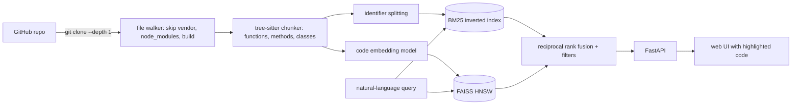

# Semantic Code Search

**Search GitHub code by meaning ("retry a request with backoff"), not just by keywords. AST-aware chunking with tree-sitter, code embeddings, a FAISS HNSW index, identifier-aware BM25, hybrid ranking and a web UI, evaluated on real repositories.**


[](https://github.com/Alkarim786/semantic-code-search/actions/workflows/ci.yml)
[](LICENSE)

---

## Why
`grep` and GitHub search find code only when you already know its exact names. Developers usually know *what* the code does, not what it's called. This engine:
- splits code into the units people actually look for (functions, methods, classes) with **tree-sitter**;
- embeds them with a model trained on natural-language ↔ code pairs (CodeSearchNet);
- combines that with an identifier-aware keyword index (`getHTTPResponse` → get, http, response);
- ranks the results and shows each hit with a link to the exact lines on GitHub.

## Architecture


- **Chunker** (`chunker.py`): for Python, JavaScript, TypeScript/TSX, Go, Java and Rust, it emits one chunk per definition. Each chunk has a **qualified name** (`Session.request`), signature, docstring or leading doc-comment, and exact line span. Classes get a header chunk, and their methods are indexed separately. Definitions longer than 80 lines are split into overlapping windows. Unsupported files fall back to line windows.
- **Lexical** (`lexical.py`): BM25 over identifier sub-tokens plus the original identifier, so both "parse url" and `parseURL` match.
- **Semantic** (`index.py`): `flax-sentence-embeddings/st-codesearch-distilroberta-base` (trained on CodeSearchNet), L2-normalised, in a FAISS `IndexHNSWFlat` (M=32, efSearch=64). An exact flat index is used to measure ANN quality.
- **Search** (`search.py`): `bm25`, `dense` or `hybrid` (RRF, k=60), with language, repo and path filters.

## Tech stack
| Tech | Why |
|---|---|
| **tree-sitter** (language pack) | One fast, error-tolerant parser API for many languages; exact byte and line spans |
| **sentence-transformers**, CodeSearchNet model | Trained for exactly this task (docstring ↔ function); runs on CPU |
| **FAISS HNSW** | Sub-millisecond approximate search; scales to millions of vectors |
| **BM25 written from scratch** | Identifier-aware tokenisation that generic text search engines don't do |
| **FastAPI** + static UI with highlight.js | Simple API, background indexing jobs, readable results |

## Features
**Implemented**
- Index any public GitHub repo (`POST /api/index {"repo": "owner/name"}`), with background jobs and status in `/api/stats`.
- Hybrid, semantic-only or keyword-only search; filters by language, repo and path.
- Results link to `github.com/<repo>/blob/HEAD/<path>#L<start>-L<end>`.
- Index persistence (chunks, vectors, BM25 state, FAISS index); Docker and CI.

**Roadmap**
- Better fusion (weighted RRF or a learned reranker): see the evaluation, where RRF with an equal-weight BM25 slightly *hurt*.
- Cross-encoder reranking of the top 50; query expansion with identifier synonyms.
- Incremental re-indexing on `git pull`; a GPU embedding path; larger models such as `jina-embeddings-v2-base-code`.

## Key engineering decisions
- **Leak-free evaluation.**
  - Queries are each function's docstring summary, so the index is built with docstrings **stripped** from the code *and* from the stored doc field (`strip_docstrings=True`).
  - Otherwise BM25 would just match the query against its own docstring.
  - A unit test asserts that the query text appears nowhere in the indexed chunk.
- **Tree-sitter grammar differences.** In the installed Python grammar, a docstring is a bare `string` node, not one wrapped in `expression_statement`. The first version missed every docstring; a test caught it.
- **HNSW vs exact.** Measured, not assumed: **99.7% recall@10 against exact search at 0.59 ms vs 1.70 ms per query** on 4,253 vectors. The gap widens as the corpus grows.
- **Fusion is not free.** Plain RRF gives BM25 equal weight. When BM25 is clearly weaker (MRR 0.40 vs 0.54 here), hybrid lands *between* the two rather than above both. Default mode stays hybrid, because it wins on exact-identifier queries the docstring eval doesn't measure. The numbers are reported as they came out.

## Evaluation (real, measured 2026-10-28)
Setup:
- **Corpus:** `psf/requests`, `pallets/flask`, `pallets/click` and `encode/httpx` (shallow clones), giving **4,253 chunks** from 4,116 definitions.
- **Queries:** 400 randomly sampled functions and methods with a docstring summary of at least 4 words. The query is the docstring's first sentence; the target is that definition.
- **Hardware:** AMD Ryzen 5 7520U (4C/8T), CPU only, Windows 11. The laptop was on battery with roughly 30% background CPU load.

| Mode | MRR@10 | Recall@1 | Recall@10 | p50 query latency | p95 |
|---|---|---|---|---|---|
| BM25 (identifier-aware) | 0.400 | 0.290 | 0.645 | 2.5 ms | 6.1 ms |
| **Dense (CodeSearchNet model + HNSW)** | **0.539** | **0.408** | **0.805** | 71 ms | 152 ms |
| Hybrid (RRF) | 0.520 | 0.375 | 0.793 | 77 ms | 288 ms |

| ANN check | Value |
|---|---|
| HNSW recall@10 vs exact search | **0.997** |
| Vector search p50: exact / HNSW | 1.70 ms / **0.59 ms** |
| Embedding all 4,253 chunks (CPU) | 1,236 s |

Dense query latency is dominated by **encoding the query on the CPU** (~70 ms); the vector search itself is under 1 ms. Reproduce with `python -m codesearch.evaluate`.

## Quick start
```bash
docker compose up --build                    # http://localhost:8000
curl -X POST localhost:8000/api/index -H 'content-type: application/json' -d '{"repo":"psf/requests"}'
curl "localhost:8000/api/stats"              # watch the job finish, then search in the UI
```
Local: `pip install torch --index-url https://download.pytorch.org/whl/cpu && pip install -e ".[ml,dev]" && uvicorn codesearch.api:app`.

## API
- `GET /api/search?q=retry%20with%20backoff&k=10&mode=hybrid&language=python&repo=psf/requests&path=adapters`
  ```json
  {"query": "...", "took_ms": 74.1, "results": [{"repo": "psf/requests", "path": "src/requests/adapters.py", "kind": "method",
    "name": "HTTPAdapter.send", "start_line": 590, "end_line": 680, "url": "https://github.com/psf/requests/blob/HEAD/...#L590-L680",
    "score": 0.0325, "bm25_rank": 3, "dense_rank": 1, "code": "def send(self, request, ..."}]}
  ```
  (The example values are illustrative; actual ranks and lines depend on the indexed commit.)
- `POST /api/index {"repo": "owner/name"}` → `202 {"status": "queued"}`
- `GET /api/stats` → chunk counts per repo and language, embedder name, job status
- `GET /` → web UI · `GET /health`

## Testing
```bash
pytest     # 15 tests, using a deterministic hashing embedder, so no model download is needed
```
Covers:
- qualified names, docstrings and line numbers for Python; JS, TS and Go definitions; long-function splitting and file fallback;
- **leak-free docstring stripping**; identifier splitting;
- BM25 and RRF; all search modes plus filters; HNSW agreeing with exact search;
- persistence round-trip; API contract and validation; GitHub URL parsing (rejects path traversal); evaluation metric helpers.

## Project structure
```
codesearch/
  chunker.py    tree-sitter definitions -> chunks (qualified names, docs, spans)
  lexical.py    identifier splitting + BM25
  index.py      embedders (sentence-transformers / hashing), FAISS HNSW + exact, persistence
  search.py     bm25 / dense / hybrid (RRF) with filters
  repos.py      shallow clone + source walker
  evaluate.py   leak-free CodeSearchNet-style evaluation
  api.py        FastAPI + background indexing;  static/index.html  web UI
tests/  ·  Dockerfile  ·  docker-compose.yml  ·  .github/workflows/ci.yml
```

## License
[MIT](LICENSE) © Karim (Alkarim786)
